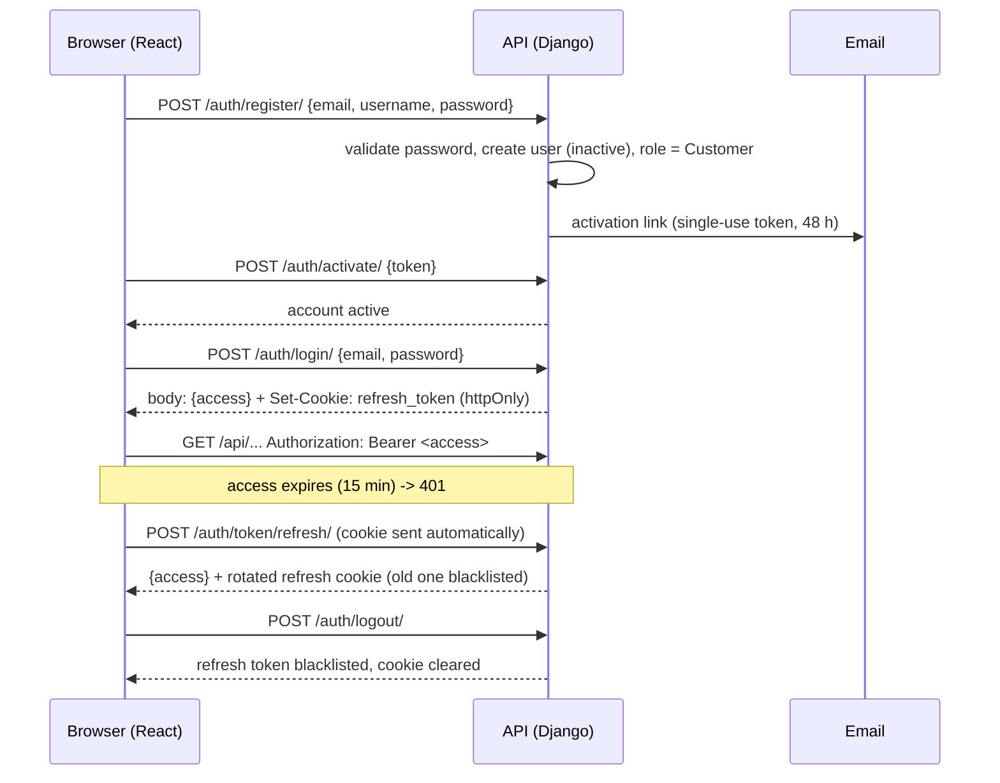
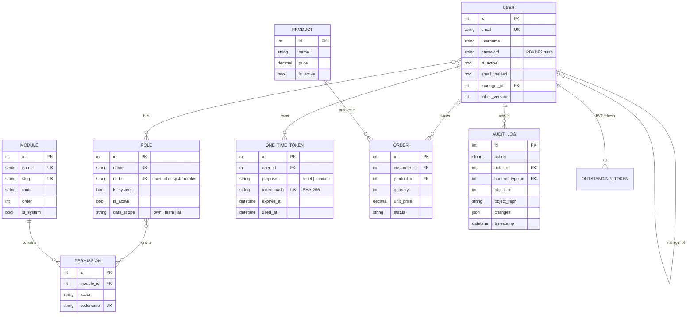

# Enterprise Authentication System

Django REST Framework + React app with JWT authentication and role-based access control (RBAC): five roles, module-level permissions, data scoping (own / team / all records), audit logging, and a data-driven menu.

- **Backend:** Django 6, DRF, SimpleJWT (with blacklist), PostgreSQL, drf-spectacular
- **Frontend:** React 19 (Create React App), React Router, Axios

## Contents

- [Quick start](#quick-start)
- [Demo users](#demo-users)
- [Authentication flow](#authentication-flow)
- [Authorization model](#authorization-model)
- [Role / permission matrix](#role--permission-matrix)
- [ER diagram](#er-diagram)
- [API reference](#api-reference)
- [Security decisions](#security-decisions)
- [Tests](#tests)

## Quick start

### Backend

```bash
python -m venv .venv
.venv\Scripts\activate            # macOS/Linux: source .venv/bin/activate
pip install -r requirements.txt

copy .env.example .env            # then edit: DJANGO_SECRET_KEY, DB_*, DEMO_PASSWORD
# create the database once:  createdb enterprise_auth

python manage.py migrate
python manage.py seed_data --demo  # modules, permissions, 5 roles, demo users + data
python manage.py runserver
```

- API: http://localhost:8000/api/
- Swagger UI: http://localhost:8000/api/docs/ (raw schema: `/api/schema/`, also saved in [docs/openapi.yaml](docs/openapi.yaml))
- Emails (activation and password-reset links) are printed to the `runserver` terminal by the console email backend.

PostgreSQL is the default database. For a quick local run without PostgreSQL, set `DB_ENGINE=sqlite` in `.env`.

### Frontend

```bash
cd frontend
npm install
npm start          # http://localhost:3000
```

Set `REACT_APP_API_URL` (see `frontend/.env.example`) if the API is not on `http://localhost:8000/api/`.

## Demo users

`seed_data --demo` creates these accounts. Their password is the `DEMO_PASSWORD` value in your `.env`.

| Email | Role | Manager |
|---|---|---|
| superadmin@example.com | Super Admin | – |
| admin@example.com | Admin | – |
| manager@example.com | Manager | – |
| employee@example.com | Employee | manager@example.com |
| customer@example.com | Customer | manager@example.com |
| customer2@example.com | Customer | – |

The manager's team is employee@ and customer@, so the Manager sees their orders but not customer2's.

## Authentication flow



**Tokens**

- **Access token** (15 min) is kept in JavaScript memory only. After a page reload the app gets a new one from the refresh endpoint.
- **Refresh token** (1 day) is an `httpOnly`, `SameSite=Lax` cookie scoped to `/api/auth/`. JavaScript can't read it, so an XSS bug can't steal it. It rotates on every use and the old one is blacklisted.
- Every token carries a `tv` (token version) claim. Bumping `User.token_version` instantly invalidates **all** of a user's access and refresh tokens. This happens on password change, password reset, deactivation and "log out everywhere".
- API clients like Postman can still send `{"refresh": "..."}` in the body of `/auth/token/refresh/` and `/auth/logout/`.

**Password reset:** `POST /auth/forgot-password/` always returns the same message, whether or not the email exists. The reset link is only sent by email, never in the API response. The token is random, stored only as a SHA-256 hash in the `OneTimeToken` table, expires in 1 hour, and works once. A successful reset runs Django's password validators and revokes every existing session.

**Rate limits:** login 5/min, register 10/hour, forgot/reset password 5/hour, activation 10/hour (per IP, configurable in `.env`).

## Authorization model

Three layers decide every request:

1. **Module permission.** Each module has a `slug` and permissions named `<slug>_<action>` (e.g. `orders_view`). Each view declares a `permission_map` from action to permission. `HasModulePermission` **denies by default**: any action without a declared permission is refused, including custom `@action` endpoints.
2. **Data scope.** Each role has a scope: `own`, `team` or `all`. A user gets the widest scope of their active roles. Querysets are filtered by scope, so records outside it return **404**, not 403 (IDOR protection). A manager's team is every user whose `manager` is them.
3. **Escalation guards** (`accounts/rbac.py`):
   - You can't change your own roles.
   - You can only assign roles whose permissions you already hold, and only grant permissions you hold.
   - Only a Super Admin can grant the Super Admin role.
   - You can't edit, deactivate, delete, reset the password of, or change the roles of a user with more privileges than you.
   - System roles (the five seeded ones) can't be renamed, edited or deleted through the API. System modules can't be deleted.
   - Super Admin is identified by the role's fixed `code`, never by its name, so renaming a role grants nothing.

Role and permission changes take effect on the user's next request. No re-login is needed, because permissions are read from the database each time and not stored in the JWT.

**Menu:** `/api/auth/me/` returns the modules the user can view, with each module's `route` and `order`. The sidebar is built from that list, so adding a module or changing a role changes the menu without frontend changes.

## Role / permission matrix

✓ = granted by `seed_data`. Super Admin implicitly has every permission, including ones created later.

| Permission | Super Admin | Admin | Manager | Employee | Customer |
|---|:-:|:-:|:-:|:-:|:-:|
| user_management_view | ✓ | ✓ | ✓ | | |
| user_management_create / edit / delete | ✓ | ✓ | | | |
| role_management_view / create / edit / delete | ✓ | ✓ | | | |
| permission_management_* | ✓ | | | | |
| module_management_* | ✓ | | | | |
| products_view | ✓ | ✓ | ✓ | ✓ | ✓ |
| products_create / edit | ✓ | ✓ | | ✓ | |
| products_delete | ✓ | ✓ | | | |
| orders_view / create | ✓ | ✓ | ✓ | ✓ | ✓ |
| orders_edit (change status) | ✓ | ✓ | ✓ | | |
| orders_cancel | ✓ | ✓ | ✓ | | ✓ |
| reports_view / export | ✓ | ✓ | ✓ | | |
| auditlog_view | ✓ | ✓ | | | |
| settings_view | ✓ | ✓ | | | |
| settings_edit | ✓ | | | | |
| **Data scope** | all | all | team | own | own |

`assign_roles` and `toggle_active` on users require `user_management_edit`. `assign_permissions` on roles requires `role_management_edit`. All of them also go through the escalation guards above.

## ER diagram



## API reference

Full interactive docs are at `/api/docs/`. Summary:

| Method & path | Permission | Notes |
|---|---|---|
| POST `/api/auth/register/` | public, throttled | creates an inactive Customer and emails an activation link |
| POST `/api/auth/activate/` | public | `{token}` |
| POST `/api/auth/resend-activation/` | public, throttled | `{email}` |
| POST `/api/auth/login/` | public, throttled | returns `{access}` and sets the refresh cookie |
| POST `/api/auth/token/refresh/` | refresh cookie | rotates the cookie and returns `{access}` |
| POST `/api/auth/logout/` | logged in | blacklists **your own** refresh token |
| POST `/api/auth/logout-all/` | logged in | revokes all your tokens |
| GET `/api/auth/me/` | logged in | profile, roles, permissions, menu modules, data scope |
| POST `/api/auth/forgot-password/` | public, throttled | link sent by email only |
| POST `/api/auth/reset-password/` | public, throttled | `{token, new_password}` |
| POST `/api/auth/change-password/` | logged in | `{old_password, new_password}`; other sessions are revoked |
| `/api/users/` CRUD | `user_management_*` | scoped by data scope |
| POST `/api/users/{id}/assign_roles/` | `user_management_edit` | `{role_ids: []}` + escalation guards |
| POST `/api/users/{id}/toggle_active/` | `user_management_edit` | deactivating revokes the user's tokens |
| `/api/roles/` CRUD | `role_management_*` | system roles are read-only |
| POST `/api/roles/{id}/assign_permissions/` | `role_management_edit` | `{permission_ids: []}` |
| `/api/permissions/` CRUD | `permission_management_*` | |
| `/api/modules/` CRUD | `module_management_*` | |
| `/api/products/` CRUD | `products_*` | |
| `/api/orders/` list/create/update | `orders_view/create/edit` | scoped; customer and price are set by the server |
| POST `/api/orders/{id}/cancel/` | `orders_cancel` | pending orders only |
| GET `/api/reports/summary/`, `/api/reports/export/` | `reports_view`, `reports_export` | scoped |
| GET `/api/auditlogs/` | `auditlog_view` | filter by `action`, `actor` |
| GET `/api/dashboard/stats/` | logged in | only returns counts the caller may see |

A Postman collection is in [docs/postman_collection.json](docs/postman_collection.json). Login stores the access token in a collection variable, and Postman keeps the refresh cookie automatically.

## Security decisions

- **Deny by default** at three levels: DRF's default permission is `IsAuthenticated`, `HasModulePermission` refuses undeclared actions, and querysets are scoped.
- **Passwords** are hashed with PBKDF2 and checked by Django's validators on register, reset, change and admin edits. The user serializer never writes a raw password to the model.
- **Secrets** live in `.env` (git-ignored). The app refuses to start without `DJANGO_SECRET_KEY`. `DEBUG` defaults to `False`.
- **CORS** is limited to `CORS_ALLOWED_ORIGINS` with credentials, so only the real frontend can use the refresh cookie.
- **CSRF:** the access token is sent in a header, so CSRF can't use it. The refresh cookie is `SameSite=Lax`, which blocks cross-site POSTs, and the refresh response can't be read cross-origin because of CORS.
- **Audit log:** user create/update/delete, role assignment, activation/deactivation, role/permission/module CRUD, permission assignment, and password change/reset are all recorded with actor, object and before/after values.

## Tests

```bash
python manage.py test
```

41 tests in [accounts/tests.py](accounts/tests.py), one `APITestCase` per scenario 1–12 plus audit logging. Results: [docs/TEST_RESULTS.md](docs/TEST_RESULTS.md).
