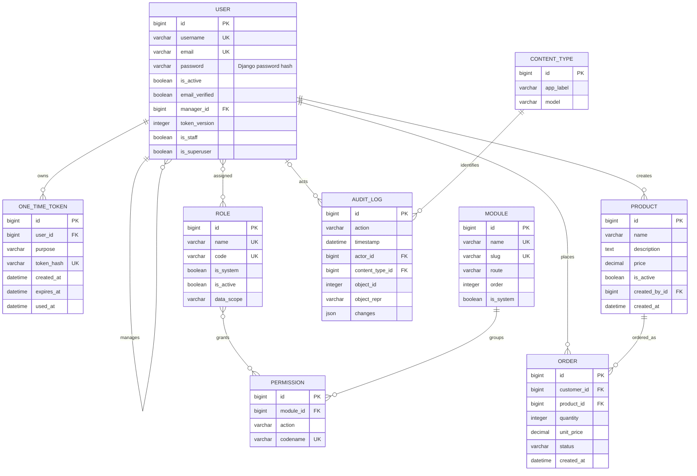

# Database design and ER diagram

The project uses Django ORM models. PostgreSQL is the configured default (`DB_ENGINE=postgresql`); SQLite can be selected with `DB_ENGINE=sqlite`. Django migrations are the source of truth for the physical schema. Table names below describe the logical schema; Django also creates framework tables and the implicit many-to-many join tables shown in the diagram.

## Entity relationship diagram

`USER`–`ROLE` and `ROLE`–`PERMISSION` are many-to-many relationships implemented by Django-generated join tables. Django's inherited user model also adds its standard group and direct-permission relations. `AUDIT_LOG` uses a generic object reference (`content_type_id`, `object_id`), so it can refer to different model types; the referenced object is not a normal database foreign key.

## Constraints and lifecycle

| Entity | Important constraints and behavior |
|---|---|
| User | Email and username are unique. Passwords are stored using Django's configured password hashers. `manager_id` is a nullable self-reference and is set to null when its manager is deleted. |
| Role | Name and stable role code are unique. `data_scope` is `all`, `team`, or `own`. The seeded Super Admin role is protected from deletion. |
| Module | Name and slug are unique. Deleting a module cascades to its permissions; system modules have API deletion protection. |
| Permission | `codename` is unique; `(module_id, action)` is unique. Deleting a module cascades to its permissions. |
| OneTimeToken | Stores only a SHA-256 token hash. Deleting its user cascades to tokens. Current registration and password-reset OTP challenges are cache-backed and are not persisted in this table. |
| Product | Price is non-negative. Deleting its creator sets `created_by_id` to null. |
| Order | Quantity is at least one. Deleting its customer cascades to orders; deleting a product referenced by an order is restricted. `unit_price` records the price at order creation. |
| AuditLog | Actor deletion sets `actor_id` to null. Content type deletion cascades to logs. `changes` is JSON. |

The ER diagram intentionally excludes Django framework tables such as sessions, content types, migrations, and JWT blacklist/outstanding-token tables. See Django migrations under each app for exact field types and database operations.
